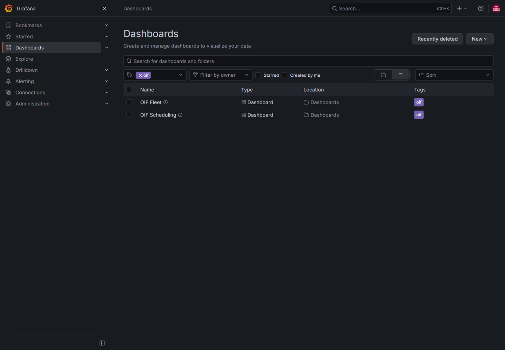
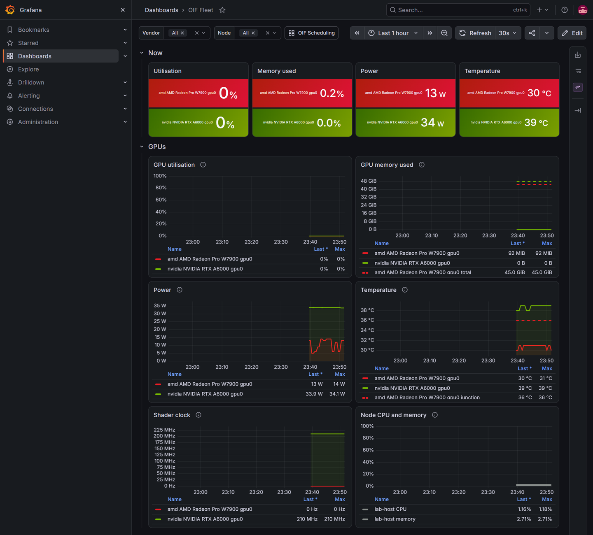
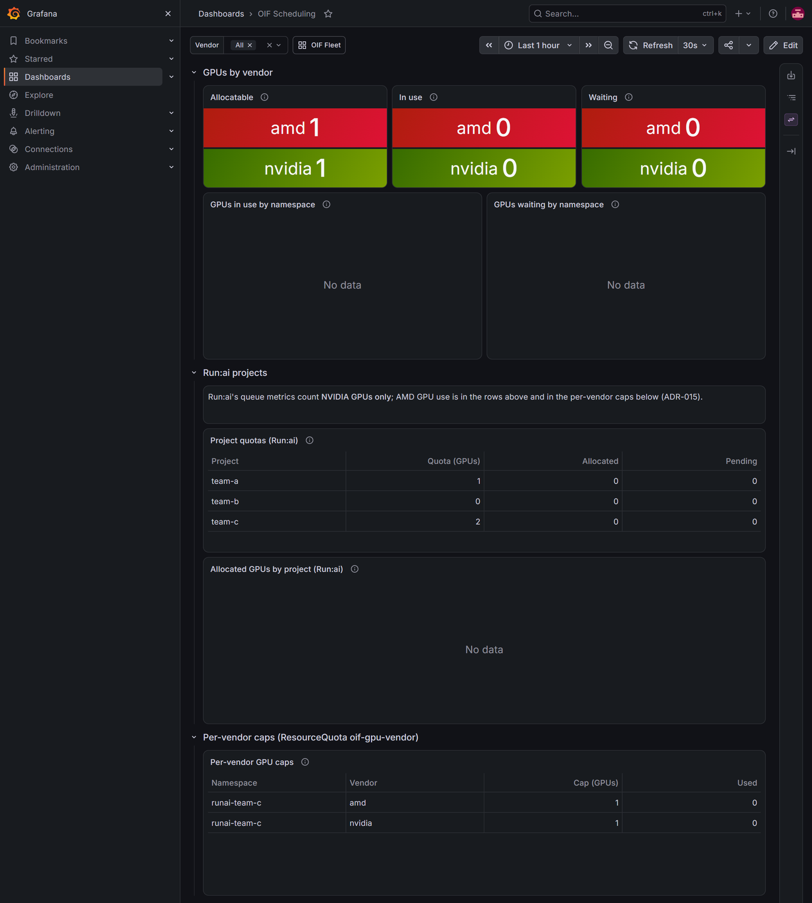

# 7. Observability for NVIDIA and AMD GPUs

**Steps:** T-112 (recording rules), T-114 (Fleet dashboard), T-106 (Scheduling dashboard). **Tested:** 2026-10-25 on the reference host, with an NVIDIA RTX A6000 and an AMD Radeon PRO W7900.

Published with screenshots as a pair: [Run:ai with NVIDIA and AMD GPUs, Installation Guide](https://manmohanbrahma.github.io/ai/runai-amd/install-guide/) and [Deployment Guide](https://manmohanbrahma.github.io/ai/runai-amd/deployment-guide/).

## What you get

- **One metric schema for both vendors.** Recording rules turn the DCGM exporter's and the AMD exporter's metrics into `oif:gpu_*` series with the same labels and units. A panel shows both GPUs without any vendor-specific query.
- **OIF Fleet:** utilisation, memory, power, temperature, shader clock for every GPU, and the host's CPU and memory.
- **OIF Scheduling:** GPUs offered, in use and waiting per vendor; Run:ai project quotas; the per-vendor caps from guide 6.
- **Grafana on HTTPS** at `https://grafana.runai.<lb-ip>.sslip.io`, with the same certificate and CA as Run:ai.

Run:ai adds both vendors into one GPU number and its inventory names only the NVIDIA GPU (ADR-015); these dashboards are where the vendors appear side by side.

## Before you start

- Guides 1 to 6 done: kube-prometheus-stack (guide 5) scrapes the DCGM exporter and the AMD exporter (guide 6).
- Your browser trusts `~/oif-ca.crt` (guide 5, browser access).

## Steps

1. Run the installer:

   ```bash
   cd ~/open-inference-fabric
   sudo ./oif install        # runs stages observability, observability-verify
   ```

2. Expected output (about 2 minutes):

   ```text
   == stage: observability
   prometheusrule.monitoring.coreos.com/oif-gpu created
     [ok] recording rules oif:gpu_*, oif:node_*, oif:project_* loaded into Prometheus
   configmap/oif-dashboards serverside-applied
     [ok] dashboards OIF Fleet and OIF Scheduling handed to Grafana
   secret/oif-tls created
   ingress.networking.k8s.io/oif-grafana created
     [ok] Grafana ingress for https://grafana.runai.<lb-ip>.sslip.io
   == stage: observability-verify
     [ok] GPU vendors recorded (oif:gpu_allocatable)
     [ok] every oif:gpu_* series covers: amd nvidia
       amd AMD Radeon Pro W7900 (gpu 0): util 0%, memory 0.1 of 45.0 GiB, 13 W, 30 °C
       nvidia NVIDIA RTX A6000 (gpu 0): util 0%, memory 0.0 of 48.0 GiB, 34 W, 38 °C
     [ok] Grafana dashboard oif-fleet
     [ok] Grafana dashboard oif-scheduling
     [ok] Grafana answers on https://grafana.runai.<lb-ip>.sslip.io (CA: ~/oif-ca.crt) with dashboards OIF Fleet and OIF Scheduling (user admin)
   ```

3. Open `https://grafana.runai.<lb-ip>.sslip.io` and log in as `admin`. The password is `GRAFANA_ADMIN_PASSWORD` from `.env`; to read it back:

   ```bash
   kubectl -n monitoring get secret grafana-admin -o jsonpath='{.data.admin-password}' | base64 -d; echo
   ```

4. **Dashboards**, filter by the tag `oif`:

   

| Stage | What it does |
| --- | --- |
| observability | Wraps `platform/observability/rules/oif-gpu.rules.yaml` in a PrometheusRule `oif-gpu`; puts both dashboards in ConfigMap `oif-dashboards` (label `grafana_dashboard=1`, read by Grafana's sidecar); copies the Run:ai certificate to secret `oif-tls`; creates ingress `oif-grafana` (class haproxy). |
| observability-verify | Waits until every `oif:gpu_*` series has a value for each vendor the node offers; prints one line per GPU; checks Grafana's health over HTTPS and that both dashboards are loaded. |

Both stages rerun by themselves when the rules, dashboards or ingress change (the stage version is a checksum of those files).

## The dashboards

**OIF Fleet.** NVIDIA in green (`#76B900`), AMD in red (`#ED1C24`). Memory totals and AMD's junction temperature are dashed lines. Variables: vendor, node.



**OIF Scheduling.** GPUs by vendor from Kubernetes (so the AMD GPU is counted), Run:ai project quotas, and the per-vendor caps. "In use" and "Waiting" show 0 and the time series show "No data" until GPU workloads run.



## The oif:* schema

All GPU series carry `{vendor, model, gpu, node}`.

| Series | NVIDIA (DCGM exporter) | AMD (device metrics exporter) |
| --- | --- | --- |
| `oif:gpu_util_ratio` (0-1) | `DCGM_FI_DEV_GPU_UTIL / 100` | `gpu_gfx_activity / 100` |
| `oif:gpu_mem_used_bytes` | `DCGM_FI_DEV_FB_USED` (MiB) | `gpu_used_vram` (MiB) |
| `oif:gpu_mem_total_bytes` | `FB_USED + FB_FREE + FB_RESERVED` (MiB) | `gpu_total_vram` (MiB) |
| `oif:gpu_power_watts` | `DCGM_FI_DEV_POWER_USAGE` | `gpu_average_package_power` |
| `oif:gpu_temp_celsius` | `DCGM_FI_DEV_GPU_TEMP` | `gpu_edge_temperature` |
| `oif:gpu_temp_junction_celsius` | (none) | `gpu_junction_temperature` |
| `oif:gpu_sm_clock_hz` | `DCGM_FI_DEV_SM_CLOCK` (MHz) | `gpu_clock{clock_type="system"}` (MHz) |

| Series | Source | Labels |
| --- | --- | --- |
| `oif:node_cpu_util_ratio`, `oif:node_mem_util_ratio` | node-exporter, mapped to the node name | node |
| `oif:gpu_allocatable` | kube-state-metrics, node allocatable | vendor, node |
| `oif:gpu_requested` | kube-state-metrics, pod requests of Running and Pending pods | vendor, namespace, phase |
| `oif:gpu_quota` | kube-state-metrics, ResourceQuota `oif-gpu-vendor` | vendor, namespace, type (hard, used) |
| `oif:project_gpu_deserved`, `_allocated`, `_pending` | Run:ai queue metrics (both vendors in one count) | project |

Query them directly in Grafana's **Explore**, for example `oif:gpu_power_watts` or `sum by (vendor) (oif:gpu_requested{phase="Running"})`.

## Check it worked

```bash
kubectl -n monitoring get prometheusrule oif-gpu
kubectl -n monitoring get configmap oif-dashboards --show-labels
kubectl -n monitoring get ingress oif-grafana
P=$(kubectl -n monitoring get svc kps-kube-prometheus-stack-prometheus -o jsonpath='{.spec.clusterIP}')
curl -s "http://$P:9090/api/v1/query" --data-urlencode 'query=count by (vendor) (oif:gpu_util_ratio)'
```

The rules have unit tests (sample DCGM, AMD, kube-state-metrics and Run:ai series in `platform/observability/rules/oif-gpu.test.yaml`), run by `tests/run.sh` with a pinned `promtool`:

```bash
bash tests/unit/test_rules.sh && echo rules ok
```

## What changed on the host

Nothing on the host itself: a PrometheusRule, a ConfigMap, a TLS secret and an ingress in namespace `monitoring`. `oif uninstall` removes them with the cluster.

## Troubleshooting

| Symptom | Cause and fix |
| --- | --- |
| A panel shows only one vendor | That vendor's exporter is not scraped. NVIDIA: `kubectl -n gpu-operator get pods -l app=nvidia-dcgm-exporter`. AMD: `kubectl -n kube-amd-gpu get pods,servicemonitor` (guide 6). Then query the raw metric, for example `DCGM_FI_DEV_GPU_UTIL` or `gpu_gfx_activity`, in Explore. |
| AMD shader clock shows 0 Hz | Normal at idle: the W7900 switches its graphics engine off. It rises under load. |
| AMD `gpu_health` 0, or the AMD GPU disappears | Kernel 7.0's phantom UMC ECC errors; see guide 6. |
| Dashboards missing in Grafana | `kubectl -n monitoring logs deploy/kps-grafana -c grafana-sc-dashboard`; the ConfigMap must carry `grafana_dashboard=1`. |
| Browser warns about the certificate | Import `~/oif-ca.crt` (guide 5); the Grafana name is covered by the Run:ai wildcard certificate. |
| `observability-verify` waits on `oif:gpu_*` | Rules are evaluated every 15-30 s after loading; a series missing for one vendor is printed with the vendors it has. |
| Run:ai's Nodes page shows more GPUs allocated than it has | Expected: Run:ai counts the AMD GPU's allocation but lists only NVIDIA GPUs in its inventory (ADR-015). Use the "GPUs by vendor" row for the split. |
