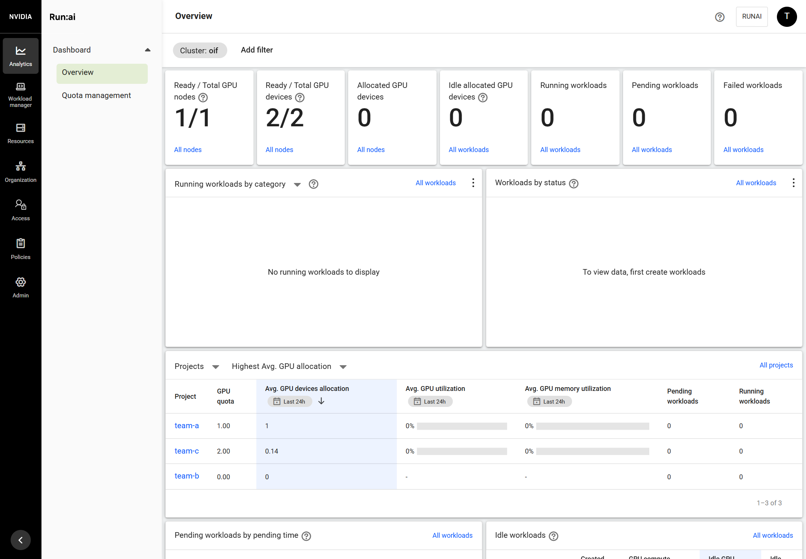
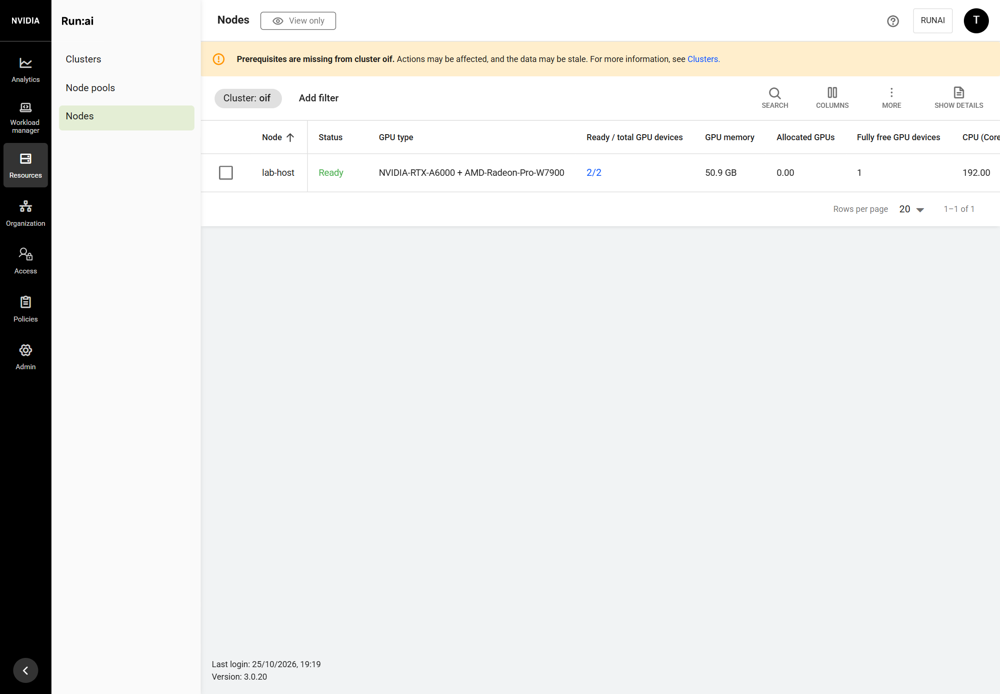
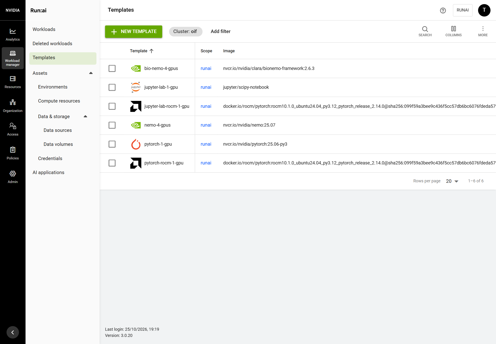
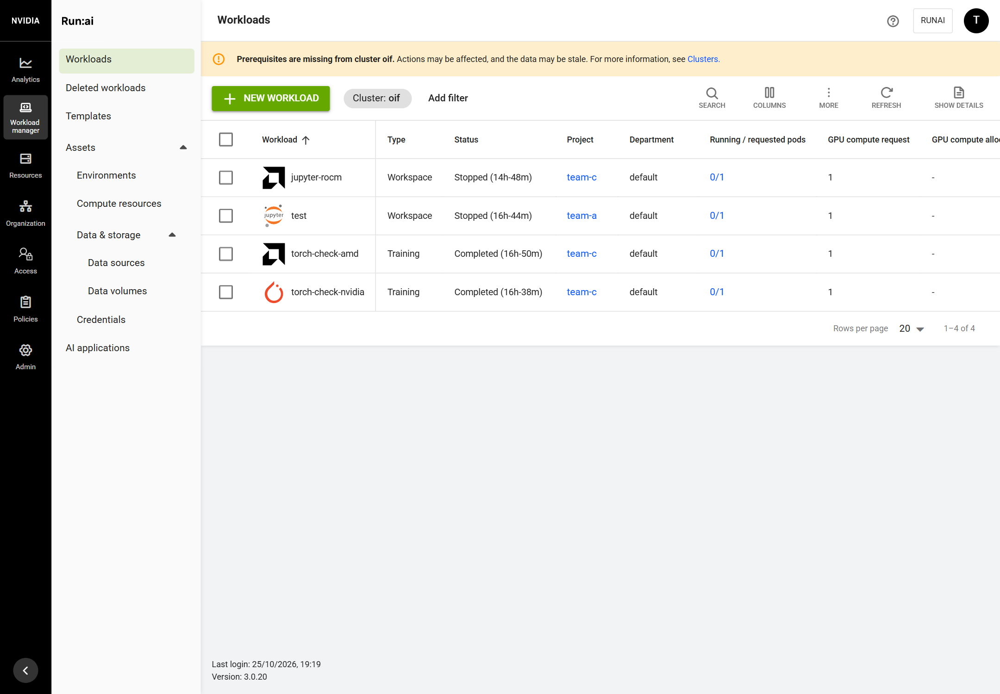
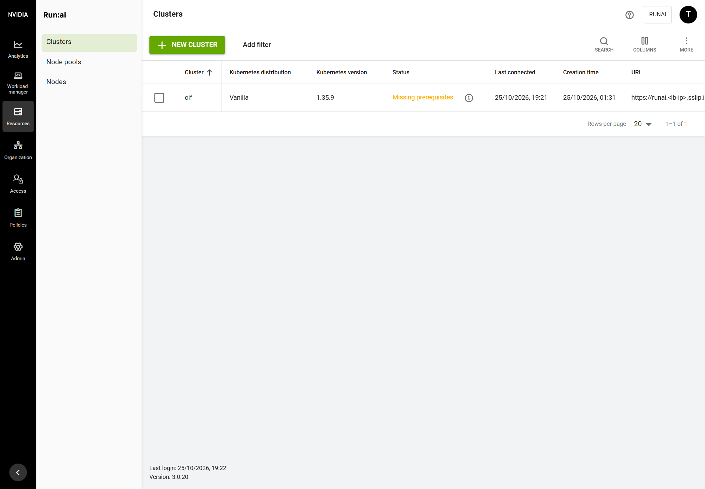

# 8. Run:ai patches and ROCm templates for AMD GPUs

**Step:** T-115. **Tested:** 2026-10-25, Run:ai 3.0.20 open source with an RTX A6000 and a Radeon PRO W7900 in one node.

Stock Run:ai 3.0.20 schedules `amd.com/gpu` but does not see the AMD GPU in its inventory: the node shows 1 GPU, the Overview 0/1 GPU devices, and AMD workloads get the generic NVIDIA icon. oif carries three small patches to the Run:ai source, builds the patched components on the cluster, and adds ROCm workload templates. RUNAI_PATCHES=none puts the stock images back.

## What you get

- Run:ai counts both GPUs: the node's GPU type is `NVIDIA-RTX-A6000 + AMD-Radeon-Pro-W7900` with 2/2 GPU devices, and the Overview shows 1/1 nodes and 2/2 GPU devices.
- Workloads and templates built on a ROCm image show the AMD logo.
- The node is Ready: Run:ai no longer marks it as missing GPU fraction prerequisites when fractions run on no node at all.
- Two templates for the AMD GPU next to Run:ai's NVIDIA ones: `pytorch-rocm-1-gpu` (training) and `jupyter-lab-rocm-1-gpu` (workspace).





## The patches

All in `patches/runai/3.0.20/`, each with unit tests that run in the build:

| Patch | Component | Change |
| --- | --- | --- |
| `0001-cluster-sync-count-amd-gpus-on-mixed-nodes.patch` | cluster-sync | Reads the AMD node labels (`amd.com/gpu.product-name`, `beta.amd.com/gpu.product-name.*`, `amd.com/gpu.vram`) as well as NVIDIA's. On a node with both vendors, the GPU type becomes `NVIDIA type + AMD type` and the GPU count is the sum; GPU memory stays NVIDIA's. |
| `0002-frontend-amd-logo-for-rocm-images.patch` | frontend (web UI) | An image whose path contains a `rocm/` segment (`rocm/pytorch`, `docker.io/rocm/...`) gets the AMD icon instead of the generic one. |
| `0003-go-operator-fractions-unavailable-without-target-nodes.patch` | go-operator | When the GPU fractioning daemons have no node to run on (both report `NoTargetNodes`), the operator reports GPU fractions unavailable instead of available. Before, every GPU node then counted as not ready (Overview: Ready 0/1 nodes). |

## How oif builds and switches them

Stage `runai-patches`, for each component with a patch:

1. Downloads the Run:ai source tarball of the release tag once into `/var/lib/oif/build/src/` and checks its pinned SHA-256 (`RUNAI_SOURCE_SHA256` in `versions.env`). On a dropping connection it retries up to 30 times.
2. Runs a Kubernetes Job in namespace `oif-build` with the pinned Go or Node image (`GO_BUILD_IMAGE`, `NODE_BUILD_IMAGE`). The Job applies the patches with `git apply`, checks `gofmt`, runs the unit tests, builds the binary or the web bundle, and layers it onto the stock image with `crane` (`CRANE_VERSION`, checksum pinned). No Docker and no registry are needed.
3. Imports the image tarball into containerd as `oif.local/runai-oss/<component>:3.0.20-oif1`.
4. Points Run:ai at it: cluster-sync through the RunaiConfig (`spec.cluster-sync.image`); frontend and go-operator by setting the deployment's image with `imagePullPolicy: IfNotPresent`, because a local image cannot be pulled. The stock pull policy is kept in the annotation `oif.ai/stock-pull-policy`.
5. Waits for the rollout, then for Run:ai to count every GPU of the node.

A component is rebuilt only when its patches, its build image or a pinned version change (record in `/var/lib/oif/build/runai/<component>.rev`). Go and npm downloads are cached in `/var/lib/oif/build/cache/`, so a re-run downloads nothing it already has.

## Before you start

- Guides 1 to 7 done.
- The host reaches `codeload.github.com`, `github.com`, `proxy.golang.org`, `registry.npmjs.org` and `nvcr.io`.

## Steps

1. Run the installer:

   ```bash
   cd ~/open-inference-fabric
   sudo ./oif install          # runs stages runai-patches and runai-amd-templates
   ```

2. Expected output (5 to 10 minutes for the first build on a normal link, seconds when nothing changed):

   ```text
   == stage: runai-patches
   == building Run:ai cluster-sync with 0001-cluster-sync-count-amd-gpus-on-mixed-nodes.patch
     [ok] cluster-sync build finished
       ok   .../cluster-sync/pkg/handlers/parsers
     [ok] patched image oif.local/runai-oss/cluster-sync:3.0.20-oif1 loaded into containerd
     [ok] Run:ai cluster-sync runs the patched image
   == building Run:ai go-operator with 0003-go-operator-fractions-unavailable-without-target-nodes.patch
     [ok] go-operator build finished
       ok   .../go-operator/pkg/controller-utils
     [ok] Run:ai go-operator runs the patched image
   == building Run:ai frontend with 0002-frontend-amd-logo-for-rocm-images.patch
     [ok] frontend build finished
            Tests  53 passed (53)
     [ok] Run:ai frontend runs the patched image
     [ok] Run:ai counts every GPU of the node
       <node> type=NVIDIA-RTX-A6000+AMD-Radeon-Pro-W7900 gpus 2
   == stage: runai-amd-templates
     [ok] template jupyter-lab-rocm-1-gpu updated
     [ok] template pytorch-rocm-1-gpu updated
   == install finished
   ```

   On a re-run with no change, each component prints `patched image ... is already built from the same patches`.

## Check it worked

```bash
kubectl -n runai get deploy cluster-sync runai-operator -o custom-columns=NAME:.metadata.name,IMAGE:.spec.template.spec.containers[0].image
kubectl -n runai-backend get deploy runai-backend-frontend -o jsonpath='{.spec.template.spec.containers[0].image}'; echo
# all three: oif.local/runai-oss/<component>:3.0.20-oif1
```

In the Run:ai web UI: **Resources > Nodes** shows the node with both GPU types and 2/2 GPU devices; **Analytics > Overview** shows 2/2.

## ROCm templates and workloads

Stage `runai-amd-templates` creates or updates the templates in `platform/runai/templates/`. They request the AMD GPU as an extended resource (`amd.com/gpu: 1`), since Run:ai's own GPU field means NVIDIA:

| Template | Kind | Image | Runs |
| --- | --- | --- | --- |
| `pytorch-rocm-1-gpu` | Training | `ROCM_PYTORCH_IMAGE` (PyTorch 2.14 on ROCm 10.1) | `python3 -c "import torch; print(torch.cuda.get_device_name(0) if torch.cuda.is_available() else 'GPU not detected')"` |
| `jupyter-lab-rocm-1-gpu` | Workspace | the same image | JupyterLab `JUPYTERLAB_VERSION`, installed with pip at start (there is no ROCm JupyterLab image), port 8888 |



The same one-line PyTorch check ran on both GPUs in project team-c (tested 2026-10-25):

| Workload | Template | Output |
| --- | --- | --- |
| torch-check-amd | `pytorch-rocm-1-gpu` | `AMD Radeon Pro W7900` |
| torch-check-nvidia | `pytorch-1-gpu` (Run:ai's, `nvcr.io/nvidia/pytorch:25.06-py3`) | `NVIDIA RTX A6000` |
| jupyter-rocm | `jupyter-lab-rocm-1-gpu` | notebook: `AMD Radeon Pro W7900`, PyTorch 2.14.0+rocm10.1.0 |

PyTorch on ROCm keeps the `torch.cuda` names, so the same code runs on both vendors.



To start one from the web UI: **Workload manager > Workloads > New workload**, choose Training or Workspace, project team-c, and the template.

## Turning the patches off

```bash
# in .env
RUNAI_PATCHES=none
sudo ./oif install --reconfigure
```

The stage puts the stock images back (stock pull policy restored) and Run:ai counts only the NVIDIA GPU again. Setting `RUNAI_PATCHES=` (empty) turns them back on.

## What changed on the host

Nothing outside oif's state folder and the cluster:

- `/var/lib/oif/build/`: the source tarball, crane, the image tarballs, Go and npm caches. Removed by `oif uninstall` with the state folder.
- containerd images `oif.local/runai-oss/*:3.0.20-oif1` and namespace `oif-build`: removed with the cluster.

## Troubleshooting

| Symptom | Cause and fix |
| --- | --- |
| `<component> build finished: not reached`, Job log ends in `curl: (18)` or `(92)` | The internet link dropped during a download. Re-run `sudo ./oif install`: the source is downloaded on the host and kept, the caches keep what was fetched. |
| `Run:ai <component> build failed` | `kubectl -n oif-build logs job/runai-patch-<component>`: a patch that no longer applies, a `gofmt` difference or a failed unit test. |
| `go-operator did not roll out the patched image`, pod in `ImagePullBackOff` | The deployment still pulls `Always`; fixed in oif (the stage sets `IfNotPresent`). Re-run the install. |
| Clusters page: **Missing prerequisites**, banner "Prerequisites are missing from cluster oif" | Expected while GPU fractions are off (T-108: they need NVIDIA driver r615 or later). Run:ai's tooltip says "GPU fractions are not deployed on any node ... As a result, GPU fractions are not supported." Whole-GPU workloads are not affected. |



## Known limits

- The node's GPU memory and "Fully free GPU devices" still come from NVIDIA's view (50.9 GB, 1 free device when idle); the AMD GPU's VRAM is not added.
- The KAI scheduler adds `nvidia.com/gpu` and `amd.com/gpu` into one GPU count per node. On a node with both vendors it can place an NVIDIA workload while only the AMD GPU is free; the kubelet then rejects the pod (`UnexpectedAdmissionError`). A KAI patch for vendor-aware placement is planned; on clusters with one vendor per node the problem does not arise.
- The patches are for Run:ai 3.0.20. A new Run:ai version needs the patches checked and a new source checksum in `versions.env`.
